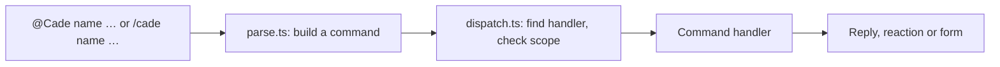

# Development

How Cade is built, and how to work on it. To set it up for your team, see [GETTING_STARTED.md](GETTING_STARTED.md); to contribute, see [CONTRIBUTING.md](CONTRIBUTING.md).

## Start developing

Cade is a Slack app on a Cloudflare Worker, and Slack can only call a public address, so the easiest way to develop it is against
a real, **separate** copy of its own: your own Cloudflare account, a Slack workspace of your own, and the setup script to join
them. Both are free.

### 1. Get your own accounts

- A **Cloudflare account** (the free plan is enough).
- A **Slack workspace** just for development: create one at <https://slack.com/create>. Don't develop in your team's real
  workspace; the app you make will post and create channels there.
- Node.js 22.18 or newer (it runs TypeScript directly, which the tests and scripts rely on), and git.

### 2. Set it up with the guided script

```sh
git clone https://github.com/XTECLK/Cade.git   # or your fork
cd Cade
npm install
npm run check       # the type check, then the whole suite, in a few seconds, without Slack
npm run setup       # Cloudflare login, the Worker, the Slack app, your first group
```

`npm run setup` deploys the Worker, creates the Slack app from `slack/manifest.json`, and asks for the first admin. The Worker is named `cade`, so use a Cloudflare account of its own for development. Then create a channel, invite Cade with `/invite @Cade`, and add it as a project from the app's Home tab.
[GETTING_STARTED.md](GETTING_STARTED.md) has every step by hand.

When you work in this repo, your settings (`cade.config.json`, `.cade/`) stay in it, ignored by git. A team's real deployment keeps them in its own repo, made from the [cade-deploy](https://github.com/XTECLK/cade-deploy) template, which sets `CADE_DEPLOY_DIR` to point the scripts there (see `scripts/paths.ts`).

### 3. Change, deploy, try

```sh
npm run check       # after each change: the type check and the tests
npm run deploy      # puts your change on your Worker, and applies new migrations
```

The code is TypeScript, with no build step of its own: wrangler bundles `src/` when it deploys, and Node runs
the tests and scripts by stripping the types. `npm run typecheck` (`tsc`) is what checks them, and `npm run check`
runs it before the tests. Only syntax that strips away is used (no `enum` or `namespace`; `tsconfig.json` enforces
it), and imports name the `.ts` file. The shapes the modules share (a task, a command, Slack's payloads,
a handler) are in `src/types.ts`; D1's rows are in `src/db.ts`; the Worker's bindings and settings in `src/env.ts`.
After changing `wrangler.toml`, run `npm run types` to regenerate `worker-configuration.d.ts`.

For a change that shouldn't change what the Worker does, such as a refactor or new types, `npm run bundle-diff`
(or `npm run bundle-diff -- <ref>`) builds the Worker as wrangler deploys it, now and at the last commit (or the
ref), and says whether its code is the same, ignoring formatting, comments and file extensions. The same code means
nothing changed, whether the tests cover it or not.

JSON that comes back in is checked against a JSON Schema at runtime (`src/validate.ts`, with
`@cfworker/json-schema`, pinned to an exact version):

- An MCP tool's arguments are checked against its `inputSchema` before it runs. An argument it doesn't list, a wrong
  type or a value out of range is refused, saying which, so the agent can correct it. Add a tool's arguments to its
  `inputSchema` in `src/mcp-tools.ts`: the schema the agent is shown is the one enforced.
- What Cade puts in its own buttons and forms (a button's value, a `block_id`, a form's `private_metadata`) is read
  with `readPayload` against its schema in `src/payloads.ts`. A message stays in Slack for good, so a button can come
  back from a message an older Cade posted: one that no longer fits is answered with a private "out of date" note
  instead of failing (see `handleInteraction` in `src/index.ts`). A schema asks only for what its reader uses, so older
  messages that still work keep working. When you change what a button carries, change its schema with it.
- What Slack sends (events, interactions, slash commands) is checked once its signature is, in `src/envelopes.ts`,
  for only the fields Cade routes it by: one that can't be read is answered 400 and logged ("Slack sent something
  Cade can't read"), not failed on halfway through a handler. Anything else Slack adds or leaves out never matters.
- `cade.config.json` is checked by `npm run config` before anything is uploaded: first the checks in
  `scripts/config.ts` for the common mistakes, which say how to fix them, then its schema in `src/config-schema.ts`
  for everything else, so a misspelt or retired setting is refused rather than uploaded to do nothing. A new setting
  goes in both the schema and `readConfig`.

Then use it in Slack. A deploy takes a few seconds. Changes to the Slack app itself (commands, scopes, events) go in
`slack/manifest.json`, and `npm run slack:update` applies them.

### 4. Debug with the live logs, and an AI agent

Watch what the Worker does while you use it:

```sh
node scripts/wrangler.ts tail      # live logs of your Worker (uses the account setup saved)
```

An AI agent makes this loop much faster. Give a coding agent (Claude Code, Gemini CLI, Cursor, …) a terminal and let it:

1. Start `wrangler tail` in the background and read the output.
2. Send the commands that reproduce the problem, such as `/cade task` or a message in the dev channel, using a Slack MCP server
   or browser automation (or, for a pure code path, a request to the Worker).
3. Read the logs for the error, change the code, run `npm test`, run `npm run deploy` and send the command again to check the fix.

A prompt to start with:

> Run `node scripts/wrangler.ts tail` in the background. In my dev Slack workspace's #acme-dev channel, send `/cade task`
> and create a task, then read the logs. If anything fails, find the cause in `src/`, fix it, add a test, deploy with
> `npm run deploy` and try again.

Keep tokens and secrets out of what you give an agent; use the dev workspace, not a real one. The agent can also connect to Cade
itself over MCP (see the [guide](https://xteclk.github.io/Cade/mcp.html)) to read the tasks it made.

### Running on your machine instead

`npm run dev` serves the Worker at `http://localhost:8787`, reloading as you edit. It takes the channels and time zone from
`cade.config.json`, and asks for the secrets each time without saving them (or takes them from the environment, such as
`SLACK_BOT_TOKEN=… npm run dev`). Slack can't reach `localhost`, so to try it against Slack, expose it with a tunnel (such as
`cloudflared tunnel --url http://localhost:8787`) and create a separate app for it: `npm run slack:create -- <tunnel URL> --name
"Cade Dev" --command /cadedev`. For most changes, deploying to your own Worker is simpler.

Other scripts:

| Script | Does |
| --- | --- |
| `npm run setup` | Takes you through the whole setup: Cloudflare, the Worker, the Slack app, then your first group |
| `npm run config` | Checks `cade.config.json` and uploads it as Worker secrets (`PROJECTS`, `TIMEZONE`, `ADMINS`, `AI_MODEL_NAME`, `MCP`) |
| `npm run db:migrate` | Applies `migrations/` to the deployed D1 database; `npm run deploy` does this after deploying, and `npm run dev` for the local one |
| `npm run schema` | Writes `schema.sql`, the database as `migrations/` leaves it, after adding a migration |
| `npm run prompts` | Checks the deploy repo's `prompts/` against the tools and saves them to D1 (`-- --check` only checks, `-- --local` saves to `npm run dev`'s database); `npm run deploy` checks before deploying and saves after |
| `npm run slack:create -- <url>` | Creates the Slack app from `slack/manifest.json` |
| `npm run slack:update` | Applies `slack/manifest.json` to the app created above |

## How it works

Slack sends three kinds of request to the Worker:

| Path | Slack feature | Handles |
| --- | --- | --- |
| `/slack/events` | Event Subscriptions | Messages: `@Cade …` commands, and plain messages Cade reacts to; opening the Home tab draws the person's dashboard (`src/home.ts`) |
| `/slack/interactions` | Interactivity | Forms, buttons and menus |
| `/slack/commands` | Slash Commands | `/cade …` |

Every request is checked against the signing secret first. Slack wants an
answer within three seconds, so slow work runs after the response, through
`waitUntil`.

Most commands are messages that start by mentioning the bot, such as
`@Cade assign @person`, because Slack doesn't allow custom slash commands in
threads and most commands are sent from a thread. Commands that start
something new outside a thread are slash commands, which can open a form
straight away.



Plain messages aren't commands, but some still mean something: a pasted PR
link, a hand-off such as "@rex please look into this", "okay, started
working on this", or "LGTM". These are **intents**. A handler declares its
intents next to its commands, each with the phrases (or a test) that signal
it, what it needs (a thread, a mention), an `order`, and what to do;
`src/intents.ts` picks the first that matches. Today there are:

| Order | Intent | In | Signals |
| --- | --- | --- | --- |
| 20 | `work` | `suggest.ts` | pull request links, linked at once from the text (`linkPasted` in `pr.ts`), with the people mentioned suggested as reviewers; hand-offs ("@mia can you review this?"), the work starting ("on it"), progress ("LGTM", "QA passed", "done"), read with AI |
| 50 | `new-thread` | `move.ts` | a message posted on its own in a dev channel, not in a thread |

Each only asks the writer, privately, before changing anything, since a
phrase can match a message that didn't mean it. Questions ("done?") and
hedged messages ("not done yet") don't count as progress.

### Where things are kept

A tracked task's thread is kept in the `messages` table: each reply is stored
by the event itself (`recordMessage` in `export.ts`), and a new task's thread
is read from Slack as it is made, so Slack's 90-day limit on the free plan
doesn't lose it. The task's card links two pages of the Worker (`web.ts`): its
thread, `/t/<channel>/<ts>`, and its notes, `/n/<channel>/<ts>`, where the
AI agent's summary and notes people type are kept (`task_notes`). Pages are
for people who can read the channel and are signed in (Settings → Web pages on the Home tab signs out of every browser): the same window gives a
link that works once and sets a 30-day cookie (`web_tokens`, hashes only). The
links are built on `PUBLIC_URL`, or the address a request came by.

Tasks are stored in D1, the `DB` binding (`db.ts`, with the tables in
`migrations/`). A new one is stored before its root message is posted
(`createTask` in `commands/track.ts`), with `ts` empty until Slack takes the
post; if Slack refuses it, the cron in `wrangler.toml` posts it again every
five minutes (`retry.ts`, through `publishTask`), up to five tries in all.
Once posted, a row is found by its channel and `ts`. `loadTask` and
`saveTask` in `tasks.ts` read and write a task; `saveTask` stores the row
first, then renders it to the root message in the dev channel
(`taskMessage`). A row's `kind` is `task` or `incident`, and `parent_id` makes
it a subtask of another task in the same channel (one level deep, see
`commands/subtask.ts`): a task is read with its parent's title and link and
its subtasks' open and closed counts and where its pull requests stand (`TASK_SELECT` in `db.ts`), which its
card shows, and saving a subtask redraws its parent's card. Slack is only written to, never read back: the task lists are a query of
open tasks. An incident is a task of `kind` `incident`: always urgent
and due immediately. A task's pull requests are links in its `prs`; where each
GitHub one stands (open, merged or closed) is a row of `pull_requests`, which the cron
fills in every 15 minutes with the deployment's `GITHUB_TOKEN` (`github.ts`), redrawing the cards
that changed. One not read yet, or not on GitHub, counts as open. Deleted tasks keep their rows, with
`deleted_at` set.

The database isn't named in `wrangler.toml`, so nothing account-specific is
committed: the first `wrangler deploy` creates one for the Worker, named
after it (`<name>-db`), and later deploys reuse it. To change the tables, add
a numbered file to `migrations/`; `npm run deploy` applies it.

### Files

| File | Role |
| --- | --- |
| `src/index.ts` | Routes, signature check, posting replies and reactions |
| `src/commands/parse.ts` | Turns a message or slash command into a command |
| `src/commands/dispatch.ts` | Finds the handler, checks where it may run, runs it, builds help |
| `src/commands/registry.ts` | The list of handlers, and the handler shape |
| `src/commands/*.ts` | One module per command: `track` (and `incident`), `assign`, `unassign`, `status`, `details` (`priority`, `due`), `pr`, `move` (and the message shortcuts), `standup`, `delete`, `replace`, `resync` (and the summary canvas's resync), `login`, `retry`; and the card's ⋯ menu (`menu`), with its forms: `edit`, `prs` (the Pull requests button), and `subtask` (Add subtask, View subtasks, `@Cade subtask`), with `subtask-link` for the admins' hidden `/cade subtask link` and `unlink` |
| `src/db.ts` | Reading and writing tasks in D1 |
| `src/retry.ts` | The cron's job: posting tasks Slack refused |
| `src/github.ts` | The cron's job: reading whether tasks' GitHub pull requests are open, merged or closed |
| `src/tasks.ts` | The task message: layout, saving, pins |
| `src/channels.ts` | `PROJECTS`: each group's dev channel |
| `src/intents.ts` | Recognising intents in plain messages |
| `src/slack.ts` | Calling Slack, Block Kit helpers, acknowledgements |
| `src/format.ts` | Times in `TIMEZONE`, and Slack users' names |
| `src/export.ts` | Keeping each tracked thread's messages in D1 (`messages`) |
| `src/notes.ts`, `src/links.ts` | A task's notes page and the addresses of its pages |
| `src/settings.ts`, `src/commands/project.ts` | the Add project button to add a project, Edit under Projects in Settings (a Slack form) for each project's switches, kept in D1 over the config, for the `admins` in the config |
| `src/web.ts`, `src/access.ts` | The Worker's pages (`/t/…` threads, `/n/…` notes), sign-in from Settings → Web pages, and who may read a channel |
| `scripts/` | `config`, `dev`, `group`, and `slack-app`, behind the npm scripts above |
| `migrations/` | The D1 tables, applied in order by `wrangler d1 migrations apply`: a change is always a new file |
| `schema.sql` | Every table and index as the migrations leave them, for reading; made by `npm run schema`, and a test fails while it is stale |
| `slack/manifest.json` | The Slack app: scopes, events, URLs, the slash command |
| `test/index.test.ts` | The tests, with `test/d1.ts`, a stand-in database on Node's SQLite |

### Adding a command

Create a module in `src/commands/` and add it to the list in
`src/commands/registry.ts`, whose comment describes the handler shape. A tidying-up command
for Cade's admins (the `admins` in `cade.config.json`) is marked `admin`, or `slashAdmin` when only
its `/cade` form is: it is left out of help, and `isAdmin` (`src/settings.ts`), the one check, is
applied to it by the dispatcher, and to its buttons and forms by the registry, so a handler never
checks for itself. A
handler declares its name, how it's used, its help section, and where it may
run (which channels, and whether only in a thread); the dispatcher enforces
these and answers with a hint when a command is used in the wrong place.
Its buttons and forms are registered on the same handler, as `actions` (by
action ID) and `views` (by form callback ID), and so are any `intents`:
to recognise a new kind of message, add an `intent({ … })` to a handler's
`intents` (the comment at the top of `src/intents.ts` has the shape), or add
words to an existing list such as `HANDOFFS`. If it needs a new Slack scope
or event, add it to `slack/manifest.json` and run `npm run slack:update`.

## AI agents

Cade is also an [MCP](https://modelcontextprotocol.io) server at `/mcp` (`src/mcp.ts`), so a person's own AI agent
reads threads and tasks and works on them as that person. It speaks Streamable HTTP in its simplest form: each POST is
one JSON-RPC message (or a batch), answered with JSON, with no sessions or streams.

- **Keys.** Settings → AI agent on the Home tab (`src/commands/configure.ts`) makes the person's API key, shown once,
  with the endpoint and a link to the setup guide; revoking it there ends it. Only a hash is kept, in `mcp_tokens`. The
  key is sent in the `x-apikey` header, never in the address. `mcp: false` in `cade.config.json` turns the endpoint off.
- **Access.** Everything runs as the key's owner: a channel's threads and tasks only for the people in it, public or
  private (`readableName` in `src/access.ts`, `readableChannel` in `src/mcp.ts`), and never a direct message.
- **Rate limit.** Each person's agent can make 60 tool calls a minute (`MCP_CALLS_PER_MINUTE` in `src/rate-limit.ts`,
  counted in `mcp_calls`); over it, the call is refused with how many seconds to wait.
- **Tools.** Each is defined in `src/mcp-tools.ts`: its name, description, `inputSchema` (checked before it runs; see
  above) and `outputSchema`. A result is text and `structuredContent` matching the schema, so IDs chain into the next
  call. The tools read tasks, threads, people, projects and availability, and write
  tasks, task messages, approval requests and task summaries. Work that is a team's own, such as an
  executive summary, is a workflow the team runs with its agent on top of these tools, not a tool of Cade's: see
  [docs/workflows.html](docs/workflows.html).
- **Prompts.** Workflows come as MCP prompts (`prompts/list`, `prompts/get`), which a person picks in their agent
  (in Claude Code, `/mcp__cade__task-summary …`). They are each deployment's own, not Cade's: Markdown files in the
  deploy repo's `prompts/` (the cade-deploy template starts it with a task's summary and an executive summary), with
  a description and arguments in the frontmatter. `npm run prompts` (`scripts/prompts.ts`) checks them against the
  tools of the checked-out Cade and saves them to the `prompts` table, replacing what was there; `npm run deploy`
  checks them first and saves them last. The Worker only reads the table (a test fails if its code writes it),
  and its prompts are part of the version agents are given, so saving them tells connected agents to reconnect. A
  prompt's text is sent only when it's picked, so it costs nothing in a session that doesn't use it.
- **The tool list.** The full list, with every argument, is
  [docs/mcp.html](docs/mcp.html), generated from `src/mcp-tools.ts`: run `npm run docs` after changing a tool (a test
  fails while it is stale). Add a tool's function to `RUNNERS` in `src/mcp.ts`: it takes its arguments as
  `src/mcp-args.ts` types them, which `npm run docs` also makes from the `inputSchema`, so the schema the agent
  sees, the check its arguments pass and the code's types can't disagree.
- **Rules for the agent.** What it is told when it connects is in `src/guardrails.ts`: above all, to show the person
  exactly what it will write and get their approval before any tool that changes something. They are the rules for
  every tool, kept under `MAX_INSTRUCTIONS` (clients cut a longer text short); what one tool needs, such as what its
  preview shows, is in that tool's description.
- **Versions.** A session ID names the tool set it loaded (a hash of the tools, the rules and the description); a tool
  called from an older session says so, and `get_server_info` reports it.
- **Summaries.** A task's summary, written by `create_task` or `update_task`, goes to the top of its notes page on the
  Worker (`/n/<channel>/<ts>`), kept in `task_notes` and marked as written by the person. After a task is made from a
  message, its form shows a short prompt to paste into the agent, naming the task by its ID (`src/commands/track.ts`);
  `aiAgentSummary: false` on a project turns that off.

## Tests

`npm test` runs `test/index.test.ts` against the real Worker, with `fetch`
replaced by a fake Slack API: `mockSlack` returns canned results and records
every call, so tests check exactly what Cade would send. Like Slack, the
fake rejects a message whose buttons share an action ID. Shared fixtures,
such as `storedTask` and `incidentTask`, build the records Cade would have
stored.
