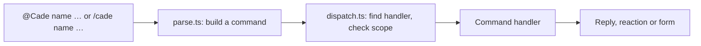

# Development

How Cade is built, and how to work on it. To set it up for your team, see [GETTING_STARTED.md](GETTING_STARTED.md); to contribute, see [CONTRIBUTING.md](CONTRIBUTING.md).

## Start developing

Cade is a Slack app on a Cloudflare Worker, and Slack can only call a public address, so the easiest way to develop it is against
a real, **separate** copy of its own: your own Cloudflare account, a Slack workspace of your own, and the setup script to join
them. Both are free.

### 1. Get your own accounts

- A **Cloudflare account** (the free plan is enough).
- A **Slack workspace** just for development: create one at <https://slack.com/create>. Don't develop in your team's real
  workspace; the app you make will post and create channels there.
- Node.js 22.18 or newer (it runs TypeScript directly, which the tests and scripts rely on), and git.

### 2. Set it up with the guided script

```sh
git clone https://github.com/XTECLK/Cade.git   # or your fork
cd Cade
npm install
npm run check       # the type check, then the whole suite, in a few seconds, without Slack
npm run setup       # Cloudflare login, the Worker, the Slack app, your first group
```

`npm run setup` deploys the Worker, creates the Slack app from `slack/manifest.json`, and asks for the first admin. The Worker is named `cade`, so use a Cloudflare account of its own for development. The Google Doc step is optional; skip
it unless you're working on the executive summary tools. Then create a channel, invite Cade with `/invite @Cade`, and add it as a project from the app's Home tab.
[GETTING_STARTED.md](GETTING_STARTED.md) has every step by hand.

When you work in this repo, your settings (`cade.config.json`, `.cade/`) stay in it, ignored by git. A team's real deployment keeps them in its own repo, made from the [cade-deploy](https://github.com/XTECLK/cade-deploy) template, which sets `CADE_DEPLOY_DIR` to point the scripts there (see `scripts/paths.mjs`).

### 3. Change, deploy, try

```sh
npm run check       # after each change: the type check and the tests
npm run deploy      # puts your change on your Worker, and applies new migrations
```

The code is TypeScript, with no build step of its own: wrangler bundles `src/` when it deploys, and Node runs
the tests and scripts by stripping the types. `npm run typecheck` (`tsc`) is what checks them, and `npm run check`
runs it before the tests. Only syntax that strips away is used (no `enum` or `namespace`; `tsconfig.json` enforces
it), and imports name the `.ts` file. The shapes the modules share (a task, a release, a command, Slack's payloads,
a handler) are in `src/types.ts`; D1's rows are in `src/db.ts`; the Worker's bindings and settings in `src/env.ts`.
After changing `wrangler.toml`, run `npm run types` to regenerate `worker-configuration.d.ts`.

JSON that comes back in is checked against a JSON Schema at runtime (`src/validate.ts`, with
`@cfworker/json-schema`, pinned to an exact version):

- An MCP tool's arguments are checked against its `inputSchema` before it runs. An argument it doesn't list, a wrong
  type or a value out of range is refused, saying which, so the agent can correct it. Add a tool's arguments to its
  `inputSchema` in `src/mcp-tools.ts`: the schema the agent is shown is the one enforced.
- What Cade puts in its own buttons and forms (a button's value, a `block_id`, a form's `private_metadata`) is read
  with `readPayload` against its schema in `src/payloads.ts`. A message stays in Slack for good, so a button can come
  back from a message an older Cade posted: one that no longer fits is answered with a private "out of date" note
  instead of failing (see `handleInteraction` in `src/index.ts`). A schema asks only for what its reader uses, so older
  messages that still work keep working. When you change what a button carries, change its schema with it.

Then use it in Slack. A deploy takes a few seconds. Changes to the Slack app itself (commands, scopes, events) go in
`slack/manifest.json`, and `npm run slack:update` applies them.

### 4. Debug with the live logs, and an AI agent

Watch what the Worker does while you use it:

```sh
node scripts/wrangler.mjs tail      # live logs of your Worker (uses the account setup saved)
```

An AI agent makes this loop much faster. Give a coding agent (Claude Code, Gemini CLI, Cursor, …) a terminal and let it:

1. Start `wrangler tail` in the background and read the output.
2. Send the commands that reproduce the problem, such as `/cade task` or a message in the dev channel, using a Slack MCP server
   or browser automation (or, for a pure code path, a request to the Worker).
3. Read the logs for the error, change the code, run `npm test`, run `npm run deploy` and send the command again to check the fix.

A prompt to start with:

> Run `node scripts/wrangler.mjs tail` in the background. In my dev Slack workspace's #acme-dev channel, send `/cade task`
> and create a task, then read the logs. If anything fails, find the cause in `src/`, fix it, add a test, deploy with
> `npm run deploy` and try again.

Keep tokens and secrets out of what you give an agent; use the dev workspace, not a real one. The agent can also connect to Cade
itself over MCP (see the [guide](https://xteclk.github.io/Cade/mcp.html)) to read the tasks it made.

### Running on your machine instead

`npm run dev` serves the Worker at `http://localhost:8787`, reloading as you edit. It takes the channels and time zone from
`cade.config.json`, and asks for the secrets each time without saving them (or takes them from the environment, such as
`SLACK_BOT_TOKEN=… npm run dev`). Slack can't reach `localhost`, so to try it against Slack, expose it with a tunnel (such as
`cloudflared tunnel --url http://localhost:8787`) and create a separate app for it: `npm run slack:create -- <tunnel URL> --name
"Cade Dev" --command /cadedev`. For most changes, deploying to your own Worker is simpler.

Other scripts:

| Script | Does |
| --- | --- |
| `npm run setup` | Takes you through the whole setup: Cloudflare, the Worker, the Slack app, Google, then your first group |
| `npm run config` | Checks `cade.config.json` and uploads it as Worker secrets (`PROJECTS`, `TIMEZONE`, `GOOGLE_URL`, `MCP`) |
| `npm run db:migrate` | Applies `migrations/` to the deployed D1 database; `npm run deploy` does this after deploying, and `npm run dev` for the local one |
| `npm run slack:create -- <url>` | Creates the Slack app from `slack/manifest.json` |
| `npm run slack:update` | Applies `slack/manifest.json` to the app created above |
| `npm run google:create` | Creates the Google web app (each group's executive-summary Doc) with clasp, and gives the Worker its address and secret |
| `npm run google:update` | Pushes `google/` and redeploys it to the same address |

## How it works

Slack sends three kinds of request to the Worker:

| Path | Slack feature | Handles |
| --- | --- | --- |
| `/slack/events` | Event Subscriptions | Messages: `@Cade …` commands, and plain messages Cade reacts to; opening the Home tab draws the person's dashboard (`src/home.ts`) |
| `/slack/interactions` | Interactivity | Forms, buttons and menus |
| `/slack/commands` | Slash Commands | `/cade …` |

Every request is checked against the signing secret first. Slack wants an
answer within three seconds, so slow work runs after the response, through
`waitUntil`.

Most commands are messages that start by mentioning the bot, such as
`@Cade assign @person`, because Slack doesn't allow custom slash commands in
threads and most commands are sent from a thread. Commands that start
something new outside a thread are slash commands, which can open a form
straight away.



Plain messages aren't commands, but some still mean something: a pasted PR
link, a hand-off such as "@rex please look into this", "okay, started
working on this", or "LGTM". These are **intents**. A handler declares its
intents next to its commands, each with the phrases (or a test) that signal
it, what it needs (a thread, a mention), an `order`, and what to do;
`src/intents.ts` picks the first that matches. Today there are:

| Order | Intent | In | Signals |
| --- | --- | --- | --- |
| 20 | `work` | `suggest.ts` | pull request links (linked, with the people mentioned as reviewers), hand-offs ("@mia can you review this?"), the work starting ("on it"), progress ("LGTM", "QA passed", "done"), read with AI; pasted links by their text |
| 50 | `new-thread` | `move.ts` | a message posted on its own in a dev channel, not in a thread |

Each only asks the writer, privately, before changing anything, since a
phrase can match a message that didn't mean it. Questions ("done?") and
hedged messages ("not done yet") don't count as progress.

### Where things are kept

A tracked task's thread is kept in the `messages` table: each reply is stored
by the event itself (`recordMessage` in `export.ts`), and a new task's thread
is read from Slack as it is made, so Slack's 90-day limit on the free plan
doesn't lose it. The task's card links two pages of the Worker (`web.ts`): its
thread, `/t/<channel>/<ts>`, and its notes, `/n/<channel>/<ts>`, where the
AI agent's summary and notes people type are kept (`task_notes`). Pages are
for people who can read the channel and are signed in (Configure → Web pages on the Home tab signs out of every browser): the same window gives a
link that works once and sets a 30-day cookie (`web_tokens`, hashes only). The
links are built on `PUBLIC_URL`, or the address a request came by.

Tasks are stored in D1, the `DB` binding (`db.ts`, with the tables in
`migrations/`). A new one is stored before its root message is posted
(`createTask` in `commands/track.ts`), with `ts` empty until Slack takes the
post; if Slack refuses it, the cron in `wrangler.toml` posts it again every
five minutes (`retry.ts`, through `publishTask`), up to five tries in all.
Once posted, a row is found by its channel and `ts`. `loadTask` and
`saveTask` in `tasks.ts` read and write a task; `saveTask` stores the row
first, then renders it to the root message in the dev channel
(`taskMessage`). Slack is only written to, never read back: the task lists are a query of
open tasks. An incident is a task with `source_incident` set: always urgent
and due immediately. A task's PRs sent to the client with `@Cade release`
are rows of `releases`, one per release, with its PRs and what it
completes; a task is loaded with them (`getTask`), and its message shows
which PRs shipped with which release. Deleted tasks keep their rows, with
`deleted_at` set. Open tasks are pinned, for people to find in Slack.

The `requirements` table, and tasks' `source_channel`, `source_thread_ts`
and `source_link`, are left from when a group could have a client channel,
and are no longer read.

The database isn't named in `wrangler.toml`, so nothing account-specific is
committed: the first `wrangler deploy` creates one for the Worker, named
after it (`<name>-db`), and later deploys reuse it. To change the tables, add
a numbered file to `migrations/`; `npm run deploy` applies it.

### Files

| File | Role |
| --- | --- |
| `src/index.ts` | Routes, signature check, posting replies and reactions |
| `src/commands/parse.ts` | Turns a message or slash command into a command |
| `src/commands/dispatch.ts` | Finds the handler, checks where it may run, runs it, builds help |
| `src/commands/registry.ts` | The list of handlers, and the handler shape |
| `src/commands/*.ts` | One module per command: `track` (and `incident`), `assign`, `unassign`, `status`, `details` (`priority`, `due`), `pr`, `release`, `move` (and the message shortcuts), `standup`, `delete`, `replace`, `resync` (and the summary canvas's resync), `login`, `retry` |
| `src/db.ts` | Reading and writing tasks in D1 |
| `src/retry.ts` | The cron's job: posting tasks Slack refused |
| `src/tasks.ts` | The task message: layout, saving, pins |
| `src/channels.ts` | `PROJECTS`: each group's dev channel |
| `src/intents.ts` | Recognising intents in plain messages |
| `src/slack.ts` | Calling Slack, Block Kit helpers, acknowledgements |
| `src/google.ts` | Calling the Google web app |
| `src/format.ts` | Times in `TIMEZONE`, and Slack users' names |
| `src/export.ts` | Keeping each tracked thread's messages in D1 (`messages`) |
| `src/notes.ts`, `src/links.ts` | A task's notes page and the addresses of its pages |
| `src/settings.ts`, `src/commands/project.ts` | the Add project button to add a project, the Project settings button in Configure (a Slack form) for each project's switches, kept in D1 over the config, for the `admins` in the config |
| `src/web.ts`, `src/access.ts` | The Worker's pages (`/t/…` threads, `/n/…` notes), sign-in from Configure → Web pages, and who may read a channel |
| `src/doc.ts` | Writing executive summaries to each group's Google Doc, and reading them back |
| `google/` | The Google web app's Apps Script (`Code.gs`, `Doc.gs`, `appsscript.json`), and `Secret.gs`, uncommitted, which only a new web app is pushed with |
| `scripts/` | `config`, `dev`, `group`, `slack-app` and `google-app`, behind the npm scripts above |
| `migrations/` | The D1 tables, applied in order by `wrangler d1 migrations apply` |
| `slack/manifest.json` | The Slack app: scopes, events, URLs, the slash command |
| `test/index.test.ts` | The tests, with `test/d1.ts`, a stand-in database on Node's SQLite |

### Adding a command

Create a module in `src/commands/` and add it to the list in
`src/commands/registry.ts`, whose comment describes the handler shape. A
handler declares its name, how it's used, its help section, and where it may
run (which channels, and whether only in a thread); the dispatcher enforces
these and answers with a hint when a command is used in the wrong place.
Its buttons and forms are registered on the same handler, as `actions` (by
action ID) and `views` (by form callback ID), and so are any `intents`:
to recognise a new kind of message, add an `intent({ … })` to a handler's
`intents` (the comment at the top of `src/intents.ts` has the shape), or add
words to an existing list such as `HANDOFFS`. If it needs a new Slack scope
or event, add it to `slack/manifest.json` and run `npm run slack:update`.

## AI agents

Cade is also an [MCP](https://modelcontextprotocol.io) server at
`/mcp`, so a person's own AI agent can summarize a thread into a task
(`src/mcp.ts`). Every request carries the person's API key in the `x-apikey`
header, never in the address. Configure → AI agent on the Home tab gives the person a key of
their own, shown only to them with the endpoint and the commands to add it to
their agent, and revoking it there ends it; only a hash is kept, in
`mcp_tokens`. Its tools are `get_flows()`, which lists the flows Cade
supports (`src/flows.js`: `summarize_task`, `triage_tasks`, `explain_task`, `check_prs`, `report_progress`, `plan_my_work`, `create_task_from_thread`, `create_task_from_scratch`, `browse_channels`), and `get_flow(name, task_id?)`, which gives the steps of one as text and as the chain of tools to call (with where each argument comes from), so a client that doesn't show MCP prompts can follow them
too; `get_task(task_id, fields?)`, which reads one task from D1 (details, summary and notes, without its threads, but naming the thread it was made from, found in the first message of its own thread, for `get_thread_history`); and `get_thread_history(thread_id | link)`, which reads a
thread straight from Slack, as it is, kept or not (a private channel's only for someone in it);
`get_task_history(task_id)`, which reads the messages Cade kept of a tracked
task's thread from D1 (the ID, `channel:ts`, is what `get_tasks` lists) (`messages`) with the same channel rule, so it still
has what Slack's free plan hides after 90 days; `get_tasks(mine?, role?, assignee?, unassigned?, status?, limit?)`, open tasks by default, most urgent
first, the person's own or every project's in channels they can read, each with a task ID to give to the other tools; 
`get_user(user_id)`, which gives a Slack user's name; (The website's tool list and `docs/mcp.html` are generated from `src/mcp-tools.ts`: run `npm run docs` after changing a tool; a test fails when they are stale.) (`get_tasks`, `get_task`, `get_users` and `find_user_by_name` take `fields` to pick what is returned, GraphQL-style: `summary`, `notes` and the others are given only when asked for. Every tool has an `inputSchema` and an `outputSchema`; a result comes as text and as `structuredContent` matching the schema, so IDs chain into the next call.) `get_releases(status?, task_id?, project?, limit?)`, which lists the partial releases (PRs sent to the client for approval: waiting by default) with their task, PRs, note and who sent and decided them (approving is done in Slack by the approver, with no tool), and `update_release(release_id, prs?, note?)`, which adds PRs to or removes them from a release still waiting for approval (never approves or rejects it; it edits the approver's request, the card and tells the thread); `get_task` also gives a task's `prs`, each pending, pending approval or approved with the release it went with, and its `releases`, and `get_tasks` gives `prs` when asked for in `fields`; `update_task` links and unlinks PRs with `prs: { add, remove }` (one already sent to the client can't be unlinked); `get_channels(limit?)`, which lists the channels Cade is in that the person can read (project channels first); `get_channel_threads(channel_id, days?, with_replies?, limit?)`, which lists a channel's recent root messages from people that aren't tracked (Cade's own task cards and messages already moved into a task are left out), each with a `thread_id` for `get_thread_history` and `create_task`; `create_task(title, project?, priority?, due_date?, incident?, summary?, thread_id | link?)`, which makes a task or incident for the person, from a thread (its first message is moved into the task's thread, as the New task shortcut does) or from scratch, and saves the summary (the agent is told to suggest the fields, take the person's input, show the final version and get approval first; the `create_task_from_thread`, `create_task_from_scratch` and `browse_channels` flows do this, and `get_flow`/prompts take a `thread` link or ID); `get_projects()`, which lists the projects and their channels (get_tasks groups tasks by project and takes a `project` name to show only one); `get_users(limit?)`, which lists the workspace's people with their IDs; `find_user_by_name(name)`, which gives a Slack user ID for assigning; `send_task_message(task_id, text)`, which posts a message in the task's thread as Cade, with a line saying "Sent by @person" (the agent is told to show the text and get approval first; only people's mentions are kept, not @channel); `update_task(task_id, status?, priority?, due_date?, owner?, reviewer?, tester?, summary?)`, all optional but the task: it changes those fields and tells the task's thread, and saves the summary on the notes page (the agent is told to show the changes and get approval first). The summary is of the issue only,
from the thread the task was made from; what was done and how it ended are in
the task's own thread. The same flows are MCP prompts, which Claude Code lists as slash commands such
as `/mcp__cade__summarize_task`, and the form after a task is made shows the
summary flow's text. To add a flow, add it to `FLOWS` in `src/flows.js`. The summary goes to the top of the
task's notes page, a page of the Worker (`/n/<channel>/<ts>`) where the team
also types notes by hand; it is kept in `task_notes`, marked as generated by
the person.
After a task is made from a message, its form gives way to a
second one with a short prompt to paste into the agent, naming the task by
its ID, and a line pointing to the Home tab's AI agent button for an agent that isn't
connected (in `src/commands/track.ts`); `aiAgentSummary: false` on a project
turns that off. the AI agent window shows whether MCP is on, the endpoint, whether you have a key (never the key) and a link to the setup guide on the website (`docs/mcp.html`, made from the tool definitions), and the tools and flows; `/cade mcp init` replies with the MCP endpoint and the API key
to add to the agent, once; to change the key, revoking it and then
`init` again.

## Tests

`npm test` runs `test/index.test.ts` against the real Worker, with `fetch`
replaced by a fake Slack API: `mockSlack` returns canned results and records
every call, so tests check exactly what Cade would send. Like Slack, the
fake rejects a message whose buttons share an action ID. Shared fixtures,
such as `storedTask` and `incidentTask`, build the records Cade would have
stored.
