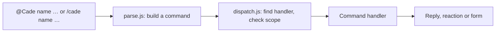

# Cade

**C.A.D.E.**, the Central Assistant for Delivery & Execution, is a Slack
app for tracking a team's work, tasks and incidents, in its own channel.
Messages from anywhere in Slack, a DM included, can be made into tasks or
moved into one. It runs as a single Cloudflare Worker, with its tasks in a
D1 database.

- **Start here:** [the Cade website](https://xteclk.github.io/Cade/)
  shows what it does, [how to set it up](https://xteclk.github.io/Cade/setup.html)
  with an AI agent, and [every command](https://xteclk.github.io/Cade/commands.html).
- [GETTING_STARTED.md](GETTING_STARTED.md) is the step-by-step setup the
  agent follows, if you'd rather follow it yourself.
- [Issues](https://github.com/XTECLK/Cade/issues) hold the changes planned
  for Cade, each with its design and status.
- This page is for working on the code.

## Development

```sh
npm install
npm test        # the whole suite, in a few seconds, without Slack
npm run dev     # the Worker on this machine
npm run deploy  # the Worker on Cloudflare
```

`npm run dev` serves the Worker at `http://localhost:8787`, reloading as you
edit. It takes the channels and time zone from
`cade.config.json`, and asks for the secrets each time without saving them
(or takes them from the environment, such as `SLACK_BOT_TOKEN=… npm run
dev`). Slack can't reach `localhost`, so to try it against Slack, expose it
with a tunnel (such as `cloudflared tunnel --url http://localhost:8787`) and
create a separate app for it: `npm run slack:create -- <tunnel URL> --name
"Cade Dev" --command /cadedev`. Deploying to a pair of test channels is
often simpler.

Other scripts:

| Script | Does |
| --- | --- |
| `npm run setup` | Takes you through the whole setup: Cloudflare, the Worker, the Slack app, optionally Google, then your first group |
| `npm run group` | Takes you through adding or changing a group: makes or links its Slack channels, adds people, can make its Doc, then saves and uploads `cade.config.json`. With `-- --name acme --tasks C… [--exportDoc new] [--workDoc new] [--taskSheet new]` it takes them at once |
| `npm run config` | Checks `cade.config.json` and uploads it as Worker secrets (`CHANNEL_PAIRS`, `TIMEZONE`, `GOOGLE_URL`) |
| `npm run db:migrate` | Applies `migrations/` to the deployed D1 database; `npm run deploy` does this after deploying, and `npm run dev` for the local one |
| `npm run slack:create -- <url>` | Creates the Slack app from `slack/manifest.json` |
| `npm run slack:update` | Applies `slack/manifest.json` to the app created above |
| `npm run google:create` | Creates the Google web app (each group's executive-summary Doc) with clasp, and gives the Worker its address and secret |
| `npm run google:update` | Pushes `google/` and redeploys it to the same address |

## How it works

Slack sends three kinds of request to the Worker:

| Path | Slack feature | Handles |
| --- | --- | --- |
| `/slack/events` | Event Subscriptions | Messages: `@Cade …` commands, and plain messages Cade reacts to; opening the Home tab draws the person's dashboard (`src/home.js`) |
| `/slack/interactions` | Interactivity | Forms, buttons and menus |
| `/slack/commands` | Slash Commands | `/cade …` |

Every request is checked against the signing secret first. Slack wants an
answer within three seconds, so slow work runs after the response, through
`waitUntil`.

Most commands are messages that start by mentioning the bot, such as
`@Cade assign @person`, because Slack doesn't allow custom slash commands in
threads and most commands are sent from a thread. Commands that start
something new outside a thread are slash commands, which can open a form
straight away.



Plain messages aren't commands, but some still mean something: a pasted PR
link, a hand-off such as "@rex please look into this", "okay, started
working on this", or "LGTM". These are **intents**. A handler declares its
intents next to its commands, each with the phrases (or a test) that signal
it, what it needs (a thread, a mention), an `order`, and what to do;
`src/intents.js` picks the first that matches. Today there are:

| Order | Intent | In | Signals |
| --- | --- | --- | --- |
| 20 | `work` | `suggest.js` | pull request links (linked, with the people mentioned as reviewers), hand-offs ("@mia can you review this?"), the work starting ("on it"), progress ("LGTM", "QA passed", "done"), read by phrases or with AI |
| 50 | `new-thread` | `move.js` | a message posted on its own in a dev channel, not in a thread |

Each only asks the writer, privately, before changing anything, since a
phrase can match a message that didn't mean it. Questions ("done?") and
hedged messages ("not done yet") don't count as progress.

### Where things are kept

A tracked task's thread is kept in the `messages` table: each reply is stored
by the event itself (`recordMessage` in `export.js`), and a new task's thread
is read from Slack as it is made, so Slack's 90-day limit on the free plan
doesn't lose it. The task's card links two pages of the Worker (`web.js`): its
thread, `/t/<channel>/<ts>`, and its notes, `/n/<channel>/<ts>`, where the
AI agent's summary and notes people type are kept (`task_notes`). Pages are
for people who can read the channel and are signed in: `/cade login` gives a
link that works once and sets a 30-day cookie (`web_tokens`, hashes only). The
links are built on `PUBLIC_URL`, or the address a request came by.

Tasks are stored in D1, the `DB` binding (`db.js`, with the tables in
`migrations/`). A new one is stored before its root message is posted
(`createTask` in `commands/track.js`), with `ts` empty until Slack takes the
post; if Slack refuses it, the cron in `wrangler.toml` posts it again every
five minutes (`retry.js`, through `publishTask`), up to five tries in all.
Once posted, a row is found by its channel and `ts`. `loadTask` and
`saveTask` in `tasks.js` read and write a task; `saveTask` stores the row
first, then renders it to the root message in the dev channel
(`taskMessage`). Slack is only written to, never read back: `/cade tasks` is a query of
open tasks. An incident is a task with `source_incident` set: always urgent
and due immediately. A task's PRs sent to the client with `@Cade release`
are rows of `releases`, one per release, with its PRs and what it
completes; a task is loaded with them (`getTask`), and its message shows
which PRs shipped with which release. Deleted tasks keep their rows, with
`deleted_at` set. Open tasks are pinned, for people to find in Slack.

The `requirements` table, and tasks' `source_channel`, `source_thread_ts`
and `source_link`, are left from when a group could have a client channel,
and are no longer read.

The database isn't named in `wrangler.toml`, so nothing account-specific is
committed: the first `wrangler deploy` creates one for the Worker, named
after it (`<name>-db`), and later deploys reuse it. To change the tables, add
a numbered file to `migrations/`; `npm run deploy` applies it.

### Files

| File | Role |
| --- | --- |
| `src/index.js` | Routes, signature check, posting replies and reactions |
| `src/commands/parse.js` | Turns a message or slash command into a command |
| `src/commands/dispatch.js` | Finds the handler, checks where it may run, runs it, builds help |
| `src/commands/registry.js` | The list of handlers, and the handler shape |
| `src/commands/*.js` | One module per command: `track` (and `incident`), `assign`, `unassign`, `status`, `details` (`priority`, `due`), `pr`, `release`, `move` (and the message shortcuts), `tasks`, `standup`, `delete`, `replace`, `resync` (and the summary canvas's resync), `login`, `retry`, `brief`, `debrief` |
| `src/db.js` | Reading and writing tasks in D1 |
| `src/retry.js` | The cron's job: posting tasks Slack refused |
| `src/tasks.js` | The task message: layout, saving, pins |
| `src/channels.js` | `CHANNEL_PAIRS`: each group's dev channel |
| `src/intents.js` | Recognising intents in plain messages |
| `src/slack.js` | Calling Slack, Block Kit helpers, acknowledgements |
| `src/google.js` | Calling the Google web app |
| `src/format.js` | Times in `TIMEZONE`, and Slack users' names |
| `src/export.js` | Keeping each tracked thread's messages in D1 (`messages`) |
| `src/notes.js`, `src/links.js` | A task's notes page and the addresses of its pages |
| `src/web.js`, `src/access.js` | The Worker's pages (`/t/…` threads, `/n/…` notes), sign-in with `/cade login`, and who may read a channel |
| `src/doc.js` | Writing executive summaries to each group's Google Doc, and reading them back |
| `google/` | The Google web app's Apps Script (`Code.gs`, `Doc.gs`, `appsscript.json`), and its uncommitted `Secret.gs` |
| `scripts/` | `config`, `dev`, `group`, `slack-app` and `google-app`, behind the npm scripts above |
| `migrations/` | The D1 tables, applied in order by `wrangler d1 migrations apply` |
| `slack/manifest.json` | The Slack app: scopes, events, URLs, the slash command |
| `test/index.test.js` | The tests, with `test/d1.js`, a stand-in database on Node's SQLite |

### Adding a command

Create a module in `src/commands/` and add it to the list in
`src/commands/registry.js`, whose comment describes the handler shape. A
handler declares its name, how it's used, its help section, and where it may
run (which channels, and whether only in a thread); the dispatcher enforces
these and answers with a hint when a command is used in the wrong place.
Its buttons and forms are registered on the same handler, as `actions` (by
action ID) and `views` (by form callback ID), and so are any `intents`:
to recognise a new kind of message, add an `intent({ … })` to a handler's
`intents` (the comment at the top of `src/intents.js` has the shape), or add
words to an existing list such as `HANDOFFS`. If it needs a new Slack scope
or event, add it to `slack/manifest.json` and run `npm run slack:update`.

## AI agents

Cade is also an [MCP](https://modelcontextprotocol.io) server at
`/mcp`, so a person's own AI agent can summarize a thread into a task
(`src/mcp.js`). Every request carries the person's API key in the `x-apikey`
header, never in the address. `/cade mcp init` gives the person a key of
their own, shown only to them with the endpoint and the commands to add it to
their agent, and `/cade mcp revoke` ends it; only a hash is kept, in
`mcp_tokens`. Its ten tools are `get_flows(name?, task_id?)`, which lists the flows Cade
supports (`src/flows.js`: `summarize_task`, `explain_task`, `plan_my_work`) and
gives the steps of one, so a client that doesn't show MCP prompts can follow them
too; `get_task(task_id | link)`, which reads one task from D1 (details, summary and notes, without its threads, but naming the thread it was made from, found in the first message of its own thread, for `get_thread_history`); and `get_thread_history(thread_id | link)`, which reads a
thread straight from Slack, as it is, kept or not (a private channel's only for someone in it);
`get_task_history(task_id | link)`, which reads the messages Cade kept of a tracked
task's thread from D1 (the ID, `channel:ts`, is what `get_tasks` lists) (`messages`) with the same channel rule, so it still
has what Slack's free plan hides after 90 days; `get_tasks(mine?, role?, assignee?, unassigned?, status?, limit?)`, open tasks by default, most urgent
first, the person's own or every project's in channels they can read, each with a task ID to give to the other tools; 
`get_user(id)`, which gives a Slack user's name; `get_users(limit?)`, which lists the workspace's people with their IDs; `find_user_by_name(name)`, which gives a Slack user ID for assigning; `send_task_message(task_id | link, text)`, which posts a message in the task's thread as Cade, marked "Sent by @person via their AI agent" (the agent is told to show the text and get approval first; only people's mentions are kept, not @channel); `update_task(task_id | link, status?, priority?, due_date?, owner?, reviewer?, tester?, summary?)`, all optional but the task: it changes those fields and tells the task's thread, and saves the summary on the notes page (the agent is told to show the changes and get approval first). The summary is of the issue only,
from the thread the task was made from; what was done and how it ended are in
the task's own thread. The same flows are MCP prompts, which Claude Code lists as slash commands such
as `/mcp__cade__summarize_task`, and the form after a task is made shows the
summary flow's text. To add a flow, add it to `FLOWS` in `src/flows.js`. The summary goes to the top of the
task's notes page, a page of the Worker (`/n/<channel>/<ts>`) where the team
also types notes by hand; it is kept in `task_notes`, marked as generated by
the person.
After a task is made from a message, its form gives way to a
second one with a short prompt to paste into the agent, naming the task by
its ID, and a line pointing to `/cade mcp init` for an agent that isn't
connected (in `src/commands/track.js`); `aiAgentSummary: false` on a project
turns that off. `/cade mcp init` replies with the MCP endpoint and the API key
to add to the agent, once; to change the key, `/cade mcp revoke` and then
`init` again.

## Tests

`npm test` runs `test/index.test.js` against the real Worker, with `fetch`
replaced by a fake Slack API: `mockSlack` returns canned results and records
every call, so tests check exactly what Cade would send. Like Slack, the
fake rejects a message whose buttons share an action ID. Shared fixtures,
such as `storedTask` and `incidentTask`, build the records Cade would have
stored.
